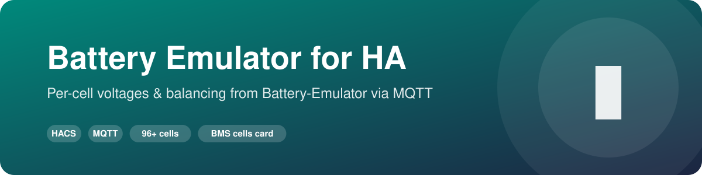
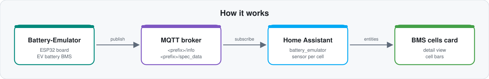
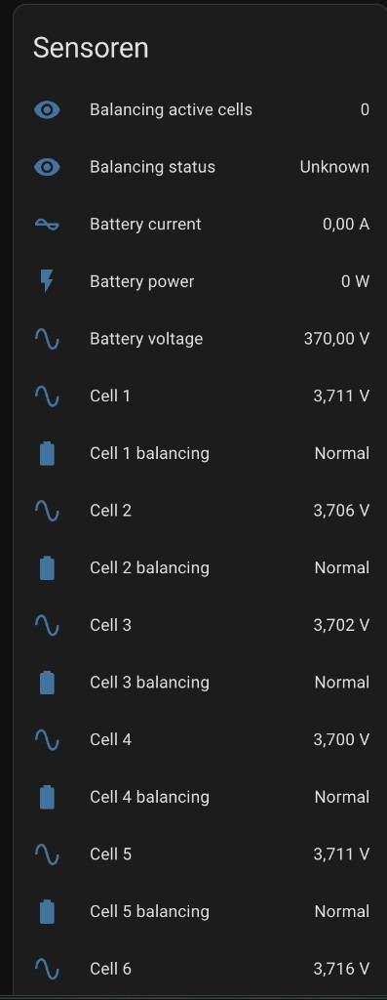
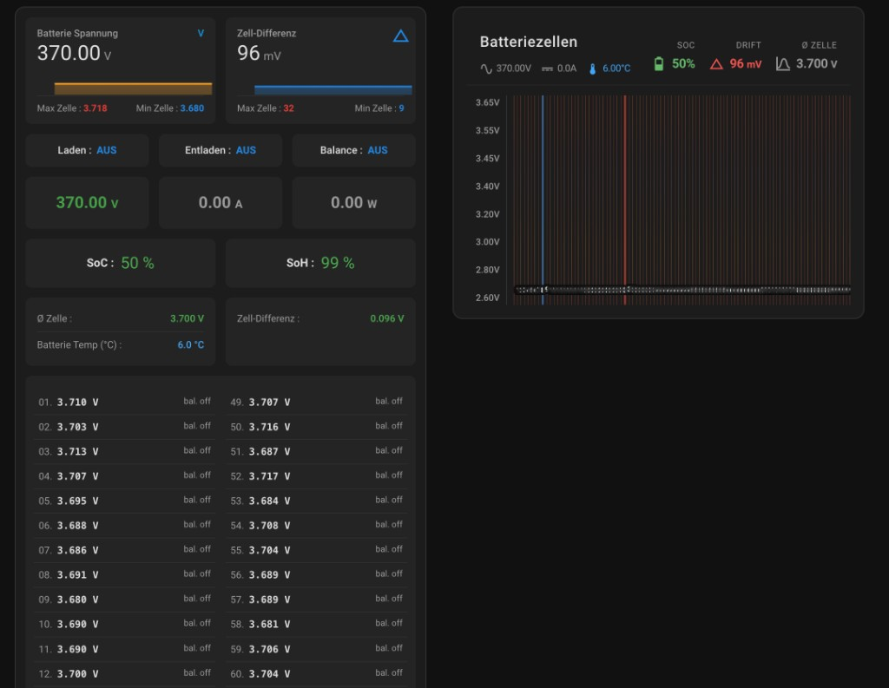

# Battery Emulator (Home Assistant)

**English** · [Deutsch](README.de.md)

[](https://hacs.xyz)



Custom integration for [Battery Emulator](https://github.com/dalathegreat/Battery-Emulator): it reads the MQTT topics (`{prefix}/info`, `{prefix}/spec_data` and, on older versions, `{prefix}/balancing_data`) and creates **one sensor entity per cell** plus **optionally one balancing status per cell** (`binary_sensor`). This feeds the [BMS Battery Cells Card](https://github.com/jayjojayson/bms-battery-cells-card) directly.

Version `1.1.1` is compatible with Home Assistant `2026.8` and tested against `2026.8.1`.



## Requirements

- Home Assistant with a configured **MQTT integration** (the broker must receive the Battery Emulator's messages).
- In Battery Emulator: MQTT enabled and **"Transmit all cell voltages"** (`mqtt_transmit_all_cellvoltages`) switched on, otherwise `spec_data` / cell voltages are missing.

## Installation (HACS)

1. HACS → **Integrations** → ⋮ → **Custom repositories**.
2. Add `https://github.com/dr-apple/Battery-Simulator_for_home_assistaint`, category **Integration**.
3. Install **Battery Emulator** and restart Home Assistant.

## Setup

**Settings → Devices & services → Add integration → Battery Emulator**

In the wizard: the MQTT topic prefix as shown in the board's web UI, a device name, optionally a second pack.

> **Battery Emulator v11:** the MQTT prefix is now the **hostname**, e.g. `battery-emulator-a1b2`. On older versions the default was `BE`. After an upgrade, adjust the entry under **Settings → Devices & services → Battery Emulator → Reconfigure**; deleting and re-adding is not necessary.

## Entities in Home Assistant

The integration creates pack voltage, current, power, SoC, SoH (if the BMS provides it), cell delta, temperatures and **per cell** a voltage sensor and (when balancing data is received) a **binary sensor** "Cell N balancing". The binary sensors **Charging**, **Discharging** and **Balancing** provide the three status indicators of the detail view.



## Dashboard: BMS Battery Cells Card

With `show_detailed_view: true` you get the overview with key figures, cell list and optional bar chart – as in this example (96 cells, entity prefix `battery_emulator`).



### Ready-made Lovelace YAML in this repository

The project contains a **complete card configuration** including all cell entities (default 1–96, shorten as needed):

**[dashboard-bms-battery-cells-card.yaml](dashboard-bms-battery-cells-card.yaml)**

**How to add it:** edit dashboard → add card → **Manual / YAML** → paste the file's content (or use the raw dashboard editor).

**Important:** if your device has a different name in HA, filter for `cell_` under *Developer tools → States* and adjust all `entity:` lines and `*_entity:` keys to your real IDs.

### Important card options (jayjojayson card)

The card's official README doesn't list all fields; the **card editor** provides these sensors, among others:

| YAML key | Purpose | Typical sensor ID of this integration |
| -------- | ------- | ------------------------------------- |
| `soc_entity` | State of charge | `sensor.…_soc` |
| `watt_entity` | Power (W) | `sensor.…_battery_power` |
| `total_voltage_entity` | Pack voltage (V) | `sensor.…_battery_voltage` |
| `total_current_entity` | Current (A) | `sensor.…_battery_current` |
| `cell_diff_sensor` | Cell delta (mV) | `sensor.…_cell_voltage_delta` |
| `temp_entity` | Temperature | `sensor.…_temperature_max` |
| `soh_entity` | State of health (%) | `sensor.…_state_of_health` |
| `stat_charge_entity` | Charging status | `binary_sensor.…_charging` |
| `stat_discharge_entity` | Discharging status | `binary_sensor.…_discharging` |
| `stat_balance_entity` | Global balancing status | `binary_sensor.…_balancing` |
| `show_detailed_view` | Detail dashboard | `true` |

Additionally: `min_voltage` / `max_voltage`, `show_min_max`, `show_average`, `show_values`, `enable_animations`, `show_legend` – see [dashboard-bms-battery-cells-card.yaml](dashboard-bms-battery-cells-card.yaml).

### Balancing per cell in the card

Each entry under `cells` can optionally get a `balance_entity` (binary sensor of this integration) so the card shows the balancing state per cell:

```yaml
cells:
  - entity: sensor.battery_emulator_cell_1
    name: "1"
    balance_entity: binary_sensor.battery_emulator_cell_1_balancing
  - entity: sensor.battery_emulator_cell_2
    name: "2"
    balance_entity: binary_sensor.battery_emulator_cell_2_balancing
```

(Same for all cells; the ready-made file contains only the voltage entities by default – add `balance_entity` as needed or via the editor.)

### Short example (excerpt)

```yaml
type: custom:bms-battery-cells-card
title: Battery cells
cells:
  - entity: sensor.battery_emulator_cell_1
    name: "1"
  - entity: sensor.battery_emulator_cell_2
    name: "2"
  # … more cells
soc_entity: sensor.battery_emulator_soc
watt_entity: sensor.battery_emulator_battery_power
total_voltage_entity: sensor.battery_emulator_battery_voltage
total_current_entity: sensor.battery_emulator_battery_current
cell_diff_sensor: sensor.battery_emulator_cell_voltage_delta
temp_entity: sensor.battery_emulator_temperature_max
soh_entity: sensor.battery_emulator_state_of_health
stat_charge_entity: binary_sensor.battery_emulator_charging
stat_discharge_entity: binary_sensor.battery_emulator_discharging
stat_balance_entity: binary_sensor.battery_emulator_balancing
show_detailed_view: true
min_voltage: 2.6
max_voltage: 3.65
```

## Example automation

Push notification when the cell voltage delta gets too large:

```yaml
triggers:
  - trigger: numeric_state
    entity_id: sensor.battery_emulator_cell_voltage_delta
    above: 50   # mV
    for: "00:05:00"
actions:
  - action: notify.mobile_app_my_phone
    data:
      title: 🔋 Battery
      message: "Cell delta {{ states('sensor.battery_emulator_cell_voltage_delta') }} mV"
```

## Duplicate entities

If **Home Assistant auto-discovery** is enabled in Battery Emulator, the broker additionally creates MQTT discovery sensors. This integration creates its own entities for the BMS card. Either disable auto-discovery in the emulator or ignore/disable the MQTT entities you don't need.

## Troubleshooting

- **All values unavailable after upgrading to v11:** check that the configured MQTT prefix matches the Battery Emulator's current hostname and use **Reconfigure** if necessary.
- **Charge / Discharge / Balance always show OFF:** update the integration to at least version 1.1.0 and take over the three `stat_*_entity` lines from the bundled dashboard YAML.
- **Cell voltages or cell balancing missing:** enable **Transmit all cell voltages** in Battery Emulator and wait for the next cell data interval (v11 sends this data together via `spec_data`).
- **`value_json is undefined` in the Home Assistant log:** this integration does not use Jinja or MQTT discovery templates for charging, discharging and balancing. The message comes from older or manually created MQTT binary sensors evaluating an empty MQTT message. First disable **Home Assistant auto-discovery** in Battery Emulator, then remove the old MQTT-discovered status entities and reload the MQTT integration. The native `binary_sensor.…_charging`, `binary_sensor.…_discharging` and `binary_sensor.…_balancing` of this integration replace those template sensors.

  If you intentionally keep the old MQTT sensors, every template must check whether `value_json` exists:

  ```jinja2
  
    
    {{ 'ON' if current is not none and current | float(0) > 0.1 else 'OFF' }}
  
    OFF
  
  ```

  For the balancing status:

  ```jinja2
  {{ 'ON' if value_json is defined
     and true in value_json.get('cell_balancing', []) else 'OFF' }}
  ```

## Note

High-voltage batteries are dangerous. Only work on them according to applicable regulations and with the necessary expertise.

## License

MIT – see [LICENSE](LICENSE). Not an official Battery-Emulator project.
